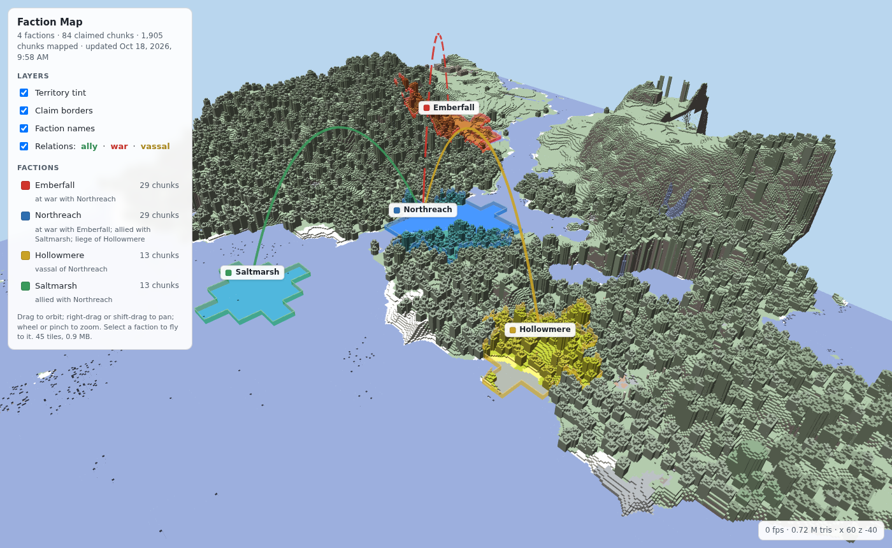
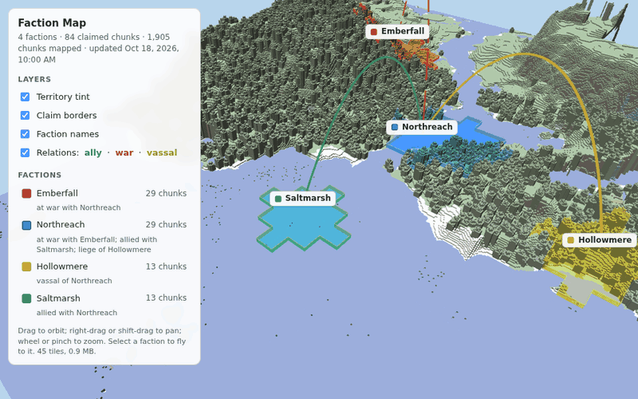
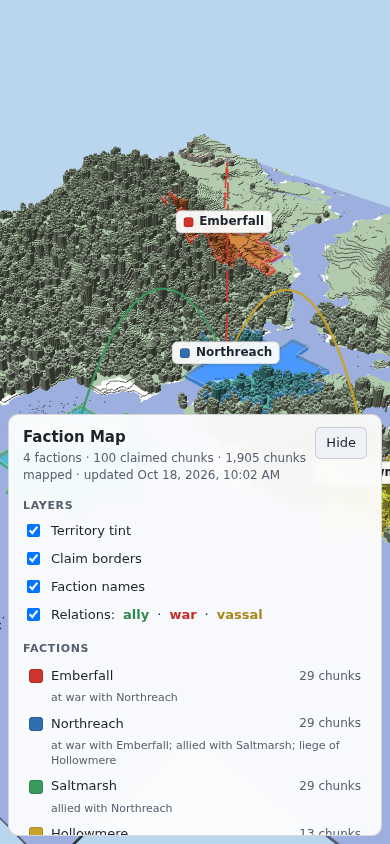

# Faction Map

## Description

Faction Map is a Minecraft plugin that draws a lightweight 3D map of a server's world in the browser, with [Medieval Factions](https://github.com/Dans-Plugins/Medieval-Factions) politics on top: each faction's territory tinted in its own colour, claim borders, faction names, and alliance, war and vassal links between factions.

It is a faction-native map, not a general-purpose one. The terrain is the top surface only: no caves, interiors, entities or lighting. That keeps it cheap. The plugin reads only chunks that players have already loaded, within a fixed main-thread budget per tick, and it never writes to the world or to Medieval Factions. Without Medieval Factions it still draws the terrain.

*Live: Saltmarsh claims more land (13 to 29 chunks) and the open viewer picks it up without a reload.*

The design is RFC 0002 in the Dans-Plugins RFC repository. This is the first milestone (M1): the skeleton, the capture and tile pipeline, the embedded web server and the faction layers.

## Installation

### First Time Installation

1. Download the plugin from the [GitHub releases page](https://github.com/Dans-Plugins/Faction-Map/releases). Take the jar from the latest stable release. The `dev` prerelease there is an automated build of `main` that has not been through any release check: use it only to try unreleased changes, and back up the server first. You can also build the jar with `./gradlew build` (see [Testing](#testing)).
2. Place the jar in the `plugins` folder of your server.
3. Optional: install [Medieval Factions](https://github.com/Dans-Plugins/Medieval-Factions) 7.0.0 or later for the faction layers.
4. Restart your server.
5. Open `http://127.0.0.1:8199/` on the server machine. The map fills in as players explore.

The viewer listens on `127.0.0.1` only. To show the map to players, put it behind your reverse proxy, or change `web.host` (see the [Configuration Guide](CONFIG.md)).

### Supported Minecraft versions

The versions in [`minecraft-versions.json`](minecraft-versions.json): **1.21.11, 26.2 and 26.3**, on Spigot or Paper. CI checks that every Bukkit class, field and method the jar uses exists on each of them, and that its bytecode (Java 21) loads on each. Folia is not supported.

## Usage

### Documentation

- [User Guide](USER_GUIDE.md) – what the map shows and how it stays up to date
- [Commands Reference](COMMANDS.md) – `/fmap`
- [Configuration Guide](CONFIG.md) – every option in `config.yml`

### What it guarantees

- **Read-only.** No block writes, no world saves, no command dispatch, no chunk loading (only chunks for which `isChunkLoaded` is true are read), and Medieval Factions through its getters only: never its database, its REST API, or a save or delete. Everything the plugin writes is under `plugins/FactionMap/` and is derived: deleting that folder is always safe and rebuilds the same tiles. CI checks this on the jar's bytecode ([`scripts/check_read_only.py`](scripts/check_read_only.py)).
- **A main-thread budget.** Capture stops each tick once `capture.mainThreadBudgetMicros` (500 µs by default) would be exceeded. Meshing, tile writing and the web server run on their own threads.
- **Works on phones.** The panel becomes a bottom sheet that can be hidden.

  

- **No player data.** The map reads no player names, UUIDs or positions. Faction names are shown by default and can be replaced with letters; faction homes are off by default.

## Support

You can find the support Discord server [here](https://discord.gg/xXtuAQ2).

### Experiencing a bug?

Please fill out a bug report [here](https://github.com/Dans-Plugins/Faction-Map/issues/new?template=bug_report.md).

- [Known Bugs](https://github.com/Dans-Plugins/Faction-Map/issues?q=is%3Aissue+is%3Aopen+label%3Abug)

## Contributing

- [CONTRIBUTING.md](CONTRIBUTING.md)

## Testing

### Unit Tests

Linux:

    ./gradlew clean test

Windows:

    .\gradlew.bat clean test

If you see `BUILD SUCCESSFUL`, the tests have passed. The build downloads the Medieval Factions 7.0.0 release jar that the integration compiles against and checks its SHA-256.

### Read-only and API checks

    python3 scripts/check_read_only.py --self-test
    python3 scripts/check_read_only.py build/libs
    curl -fsSL -o /tmp/check_api_compat.py https://raw.githubusercontent.com/Dans-Plugins/release-gates/v23/gates/check_api_compat.py
    python3 /tmp/check_api_compat.py --versions minecraft-versions.json target build/libs

`check_read_only.py` checks the jar's bytecode against the read-only rules (see [What it guarantees](#what-it-guarantees)); `check_api_compat.py` checks every Bukkit class, field and method the jar uses against each version in `minecraft-versions.json`. CI runs both after `./gradlew clean build`.

### Smoke and performance gate

[`tools/smoke/`](tools/smoke/) boots the plugin on a throwaway Spigot 26.3 server with Medieval Factions and four [mineflayer](https://github.com/PrismarineJS/mineflayer) bots, which create factions, claims and relations; the areas around their faction sites are force-loaded. [`gate.py`](tools/smoke/gate.py) then measures the performance budget: p99 main-thread time per tick ≤ 1 ms with no tick above 5 ms after warm-up, and a block change reaching the served tile in ≤ 3 s. The `Smoke` workflow runs it in GitHub Actions on every pull request. Usage reporting and bStats are switched off on that server before its first boot.

Measured on a local throwaway server: Spigot 26.3 on Temurin 25, Medieval Factions 7.0.0, ~1,480 chunks loaded, 4 bot-created factions with 84 claims and one alliance, war and vassalage each. Development machine (shared, not a production host); two runs on 2026-10-18. The bots cannot hold chunks loaded on 26.3 (they send no movement packets), so the gate now force-loads 15 × 15 chunks around each faction site to make the loaded set the same on every run:

| | Budget (RFC 0002) | Run 1 (600 s) | Run 2 (300 s) |
|---|---|---|---|
| Main thread per tick, p99 | ≤ 1 ms | 0.18 ms | 0.43 ms |
| Main thread per tick, max after warm-up | ≤ 5 ms | 0.82 ms | 2.5 ms |
| Capture per chunk, p50 (main thread) | ≤ 150 µs | 56 µs | 67 µs |
| Block change (TNT) → tile served over HTTP | ≤ 3 s typical | 1.36–1.63 s, 6 of 6 | 1.32–1.54 s, 6 of 6 |
| Tile rewrite (8 × 8 chunks, background) p50 / p95 | ≤ 50 ms | 13 / 19 ms | 18 / 31 ms |
| Tile size per update, p50 / max | ≤ 64 KB | 50 / 66 KB | 41 / 66 KB |
| Load wave (256 new chunks force-loaded), p99 / max | p99 ≤ 2 ms | – | 1.0 / 7.3 ms |

The largest tiles (mountains and forest) slightly exceed the 64 KB per-update target, and the load wave's worst tick exceeds 5 ms; both are tracked for the next milestone.

## Development

### Test Server with Plugin Hot-Reloading

A Docker-based test server is available for development.

#### Setup

1. Copy `sample.env` to `.env` and configure as needed.
2. Build the plugin: `./gradlew build`
3. Start the test server: `./up.sh`

The server listens on `localhost:25565` and the map on `http://localhost:8199/`.

#### Reloading the Plugin

To rebuild the plugin, copy the new jar into the running container and restart the server:

    ./reload-plugin.sh

#### Stopping the Test Server

    ./down.sh

## Usage reporting

Usage reporting is on by default: when the plugin is enabled, it sends its name and version to the author's [trace](https://trace.danielstephenson.dev) server so it is known which plugins are actually in use, and each `/fmap` a player runs sends one event naming the subcommand (the console and command blocks are not counted). Nothing about players, worlds or IPs is sent, apart from any tags the server's operator adds under `tags:` in `plugins/trace/config.yml`, which go with every event (see the [Configuration Guide](CONFIG.md#usage-reporting)). The plugin says on the console at every start whether reporting is on. Each event also carries a random server ID (the `server-id` line in `plugins/trace/config.yml`) so servers can be counted rather than events. It identifies no person, account or IP address; delete the line to get a new one. To turn it off:

- for this plugin: set `usage-reporting.enabled` to `false` in `plugins/FactionMap/config.yml`;
- for every plugin on the server that reports to trace: set `enabled` to `false` in `plugins/trace/config.yml` (created on first start);
- for the whole server process: set the environment variable `TRACE_USAGE_REPORTING=off` or `DO_NOT_TRACK=1`.

This version ships without a trace key, so reporting is off ("no key") until one is added in a later release.

Details: https://danielstephenson.dev/usage-reporting

## Authors and Acknowledgement

### Developers

| Name | Main Contributions |
|------|--------------------|
| Daniel McCoy Stephenson | Creator; design (RFC 0002) |

The plugin's code was drafted by Claude (Anthropic) on Daniel Stephenson's behalf.

### Third-party and reused code

- [three.js](https://threejs.org/) r128 (MIT), bundled unchanged as `src/main/resources/web/vendor/three.min.js`.
- The block colour table (`src/main/resources/colors.json`) is generated from the block catalogue of [Minecraft-USD-Exporter](https://github.com/Dans-Plugins/Minecraft-USD-Exporter) (MIT).
- The tile format and viewer come from the Kingdom First Era map prototype by the same author.
- The usage-reporting client is [trace-client-java](https://github.com/Stephenson-Software/trace-client-java) 0.6.1 (MIT), vendored.

## License

This project is licensed under the [GNU General Public License v3.0](LICENSE).

See the [LICENSE](LICENSE) file for full details.

## Project Status

This project is in active development: milestone M1 of RFC 0002. Next (M2): the bot-scripted check that every faction change reaches the map, and the event-plus-poll coverage measured end to end. Opt-in faction homes, also planned for M2, are already available (`factions.showHomes`, off by default).
